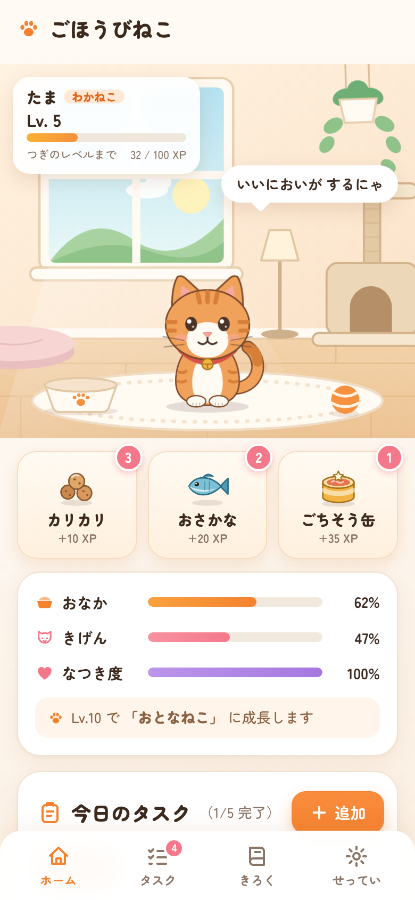
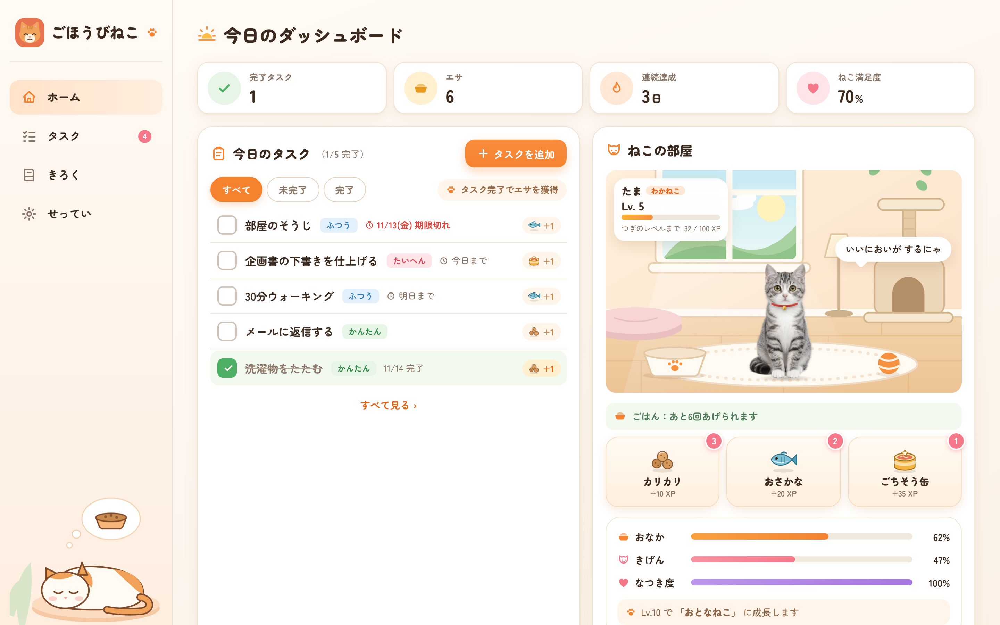

# ごほうびねこ

タスクを終えるとエサがもらえ、そのエサでねこを育てる「ごほうび型」のタスク管理 Web アプリです。
データはすべて端末のブラウザ内（IndexedDB）に保存され、サーバーや外部サービスには送信しません。

| スマートフォン | PC |
| --- | --- |
|  |  |

そのほかの画面は [`docs/screenshots/`](docs/screenshots)、実装・検証の詳細は [`docs/REPORT.md`](docs/REPORT.md) を参照してください。

## できること

- **タスク管理**：追加・編集・削除・完了・やり直し、期限、メモ、むずかしさ（かんたん／ふつう／たいへん）
- **ごほうび**：完了すると、むずかしさに応じたエサ（カリカリ／おさかな／ごちそう缶）を1つ獲得
- **育成**：エサをあげると XP と満腹度が増え、レベルアップ。Lv.5／10／15 で姿が変わる（こねこ→わかねこ→おとなねこ→ねこさま）
- **ふれあい**：ねこをタップしてなでる。満腹度は時間とともに減り、表情とセリフが変わる
- **ひとり遊び**：放っておくと、ときどき あくび・毛づくろいをし、しばらくすると眠る（夜は約25秒、昼は約3分）。眠っているときにタップすると起きる
- **時間帯**：朝・昼・夕方・夜で、窓の景色と部屋の光が変わる（夜はランプが点く）
- **進化の演出**：Lv.5／10／15 で、前の姿が光に包まれて新しい姿になる専用の演出
- **ダッシュボード**：完了タスク・エサ・連続達成・ねこ満足度のタイル、今日のタスク（すべて／未完了／完了）、今週の記録、育成メモ
- **ねこの様子**：おなか・きげん・なつき度の3つのメーター（なでる・タスク完了・ごはんで変化）
- **きろく**：今日の完了数、連続日数、成長図鑑、できごとの履歴
- **せってい**：名前の変更、バックアップ（JSON の保存／復元）、全データのリセット

## 技術スタック

| 分類 | 採用 | 理由 |
| --- | --- | --- |
| フレームワーク | Next.js 16（App Router）/ React 19 | 仕様指定。全ページ静的生成で、サーバー処理なし |
| 言語 | TypeScript 6（strict + noUncheckedIndexedAccess） | 型安全性。TS 7 は Next.js のビルド時型チェックとの相性が未確認のため見送り |
| 保存 | IndexedDB（[idb](https://github.com/jakearchibald/idb) 8） | 仕様指定。複数ストアをまたぐ更新をトランザクションで扱える |
| スタイル | 素の CSS（デザイントークン＋BEM 風クラス） | 依存を増やさず、SVG アニメーションを細かく制御するため |
| フォント | Zen Maru Gothic（@fontsource で同梱） | 外部 CDN に依存せずオフラインでもビルドできる |
| ねこ | AI生成の写真（Canva の画像生成）を背景切り抜きして WebP 化 | 写真のリアルさ。表情は4枚の写真＋動き・色で表現 |
| グラフィック | 自作 SVG（部屋・エサ・アイコン・首輪や王冠） | CSS で動かせ、時間帯や成長段階で描き分けられる |
| テスト | Vitest 5 + fake-indexeddb / Playwright 1.63 | ロジックとデータ層は単体、利用フローは E2E |

## 必要な実行環境

- Node.js 20.9 以上（開発・検証は 22.x）
- npm 10 以上
- E2E テストを動かす場合のみ Chromium（`npx playwright install chromium`）

環境変数は不要です（そのため `.env.example` はありません）。

## インストールと起動

```bash
npm install
npm run dev        # http://localhost:3000
```

## テスト

```bash
npm run typecheck  # 型チェック
npm test           # 単体テスト（Vitest）
npm run e2e        # E2E（本番ビルドを起動し、PC幅とスマホ幅の両方で実行）
```

スクリーンショットの撮り直し：

```bash
npm run build && npm run start -- -p 3100 &
node scripts/screenshots.mjs
```

## ビルド

```bash
npm run build
npm run start      # 本番モードで起動
```

## ねこの写真について

`public/cat/` の4枚（ふつう・ごきげん・食べる・あくび）は、Canva の AI 画像生成で作った写真です。背景は [rembg](https://github.com/danielgatis/rembg)（isnet-general-use モデル）で切り抜き、`scripts/prepare-cat-photos.py` で足元の位置をそろえて 480x720 の WebP にしています。

- 毛づくろい・眠るは「ごきげん」（目を閉じた写真）、おなかぺこぺこは「ふつう」を少しくすませて代用しています。
- まばたきは、目を閉じた写真を一瞬だけ重ねて表現しています。
- 成長段階は、写真の大きさと、首輪・リボン・王冠（SVG）の重ね表示で表しています。

## ディレクトリ構成

```
src/
  app/            画面（/ ホーム, /tasks, /records, /settings）と globals.css
  components/     Cat（ねこSVG）, CatRoom（部屋）, TaskList, TaskDialog, Modal, Toast ほか
  lib/
    types.ts      ドメイン型
    game.ts       ゲームルール（純粋関数：レベル・成長・満腹度・報酬・検証）
    db.ts         IndexedDB スキーマ
    repository.ts データ操作（トランザクション、バックアップの検証）
    store.tsx     React の状態管理（IndexedDB を正とする）
tests/unit/       game / repository の単体テスト
tests/e2e/        Playwright による利用フローのテスト
docs/             スクリーンショットと実装・検証レポート
```

## データ保存方式

IndexedDB のデータベース `gohobi-neko`（version 1）に保存します。

| ストア | キー | 内容 |
| --- | --- | --- |
| `tasks` | `id`（UUID） | タスク本体。index: `by-status` |
| `state` | `id`（常に `"main"`） | ねこの状態（名前・XP・満腹度など）とエサの在庫 |
| `events` | 自動採番 | 報酬獲得・エサやり・レベルアップ・成長の履歴。index: `by-at` |

- 「タスク完了＋エサ付与＋履歴追加」「エサ消費＋XP加算＋履歴追加」はそれぞれ1トランザクションで行い、途中で失敗しても中途半端な状態を残しません。
- 報酬は1タスクにつき1回だけです（`rewardClaimed`）。完了→やり直し→再完了しても増えません。
- 満腹度は「最後に更新した値と時刻」だけを保存し、表示時に経過時間から計算します（1時間に3%減少）。
- バックアップの復元時は内容を検証し、不正なファイルでは既存データを変更しません。

## ゲームバランス

| むずかしさ | もらえるエサ | XP | 満腹度 |
| --- | --- | --- | --- |
| かんたん | カリカリ | +10 | +15 |
| ふつう | おさかな | +20 | +25 |
| たいへん | ごちそう缶 | +35 | +40 |

レベル L に必要な累計 XP は `10 × L × (L−1)`（Lv.2=20, Lv.5=200, Lv.10=900, Lv.15=2100）。
| 指標 | 計算 |
| --- | --- |
| おなか | エサで増え、1時間に3%ずつ減る |
| きげん | おなか×0.6 ＋ なでた効果（最大+20、6時間で消える）＋ 今日おえたタスク（1件+10、最大+20） |
| なつき度 | なでた回数 ＋ ごはんの回数×2（最大100、下がらない） |
| ねこ満足度 | 上の3つの平均 |

数値はすべて `src/lib/game.ts` の定数で調整できます。

## デプロイ

サーバー側の処理や環境変数がないため、Next.js を動かせる環境ならそのまま公開できます。

- **Vercel**：リポジトリをインポートするだけ（Framework Preset: Next.js、設定変更不要）
- **自前の Node サーバー**：`npm ci && npm run build && npm run start`
- セキュリティヘッダー（CSP など）は `next.config.ts` の `headers()` で付けています。Vercel と `next start` では有効です。
- **静的ホスティング**：`next.config.ts` に `output: "export"` を追加すると `out/` に静的ファイルを書き出せます（この構成でのビルドは未検証。`headers()` は効かなくなるため、同じヘッダーをホスティング側で設定してください）

## 既知の制約

- データは端末・ブラウザごとに独立しています。端末間の同期やアカウント機能はありません（バックアップファイルで移行できます）。
- ブラウザのサイトデータを消すとデータも消えます。プライベートブラウズでは保存されない場合があります。
- デザイン見本にあった「カテゴリのタグ」「時刻つきの期限」「通知ベル」「日付の切り替え」「並べ替え」は未実装です（むずかしさのタグと日付の期限で代用）。
- ねこの写真は4枚のみです。毛づくろい・眠る・おなかぺこぺこ専用の写真はありません（生成サービスの利用上限のため）。写真を差し替える場合は、同じ構図の切り抜き済みPNGを用意して `scripts/prepare-cat-photos.py` を実行します。
- 通知・リマインダー、繰り返しタスク、効果音、ダークモード、オフライン起動（Service Worker）は未実装です。
- 履歴の表示は直近60件までです（保存自体は全件）。
- 動作確認は Chromium のみです。Safari / Firefox の実機確認は行っていません。
- ESLint は未導入です（型チェックとテストで担保）。
